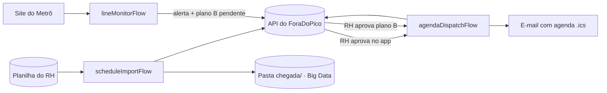

# PDD — Process Design Document · ForaDoPico RPA

> Disciplina: Robotic Process Automation · Global Solution 2026.2 · CitizenTech
> Status: **v1.0, validado em 09/11/2026**. Os diagramas BPMN oficiais são gerados a partir deste documento.

## 1. Contexto

**CitizenTech:** ForaDoPico, plataforma B2B que monta a escala presencial das empresas híbridas fugindo dos horários de pico do Metrô de São Paulo.

**Cidadão beneficiado:** o trabalhador CLT que vai ao escritório de trem ou metrô.

**Processo manual que a automação substitui:**

| Hoje (manual) | Com o robô |
|---|---|
| O RH monta a escala em planilha, confere à mão quem vai em cada dia e manda a agenda por e-mail ou WhatsApp, um por um | O robô importa a planilha, valida tudo, entrega à plataforma e envia as agendas aprovadas sozinho |
| Ninguém acompanha a situação das linhas; o funcionário descobre a falha já na plataforma | O robô monitora as linhas a cada 5 minutos e, se houver falha, propõe o plano B ao RH antes de o funcionário sair de casa |

**Benefício ao cidadão:** agenda previsível, recebida com antecedência, e um plano B (remoto ou mudança de horário) no dia em que a linha falha.

## 2. Visão geral dos fluxos



A aprovação do RH é a **pessoa no circuito** exigida pelo briefing ("IA responsável"). O robô nunca publica uma escala nem aplica um plano B sem essa aprovação.

---

## 3. Fluxo 1 — `scheduleImportFlow` (importação da escala)

### 3.1 Ficha

| Item | Descrição |
|---|---|
| Gatilho | Agendado a cada 5 minutos, ou manual pela CLI |
| Entrada | Arquivos `.xlsx` na pasta `data/input/` |
| Saídas | Escala enviada à API (`POST /scheduleImports`), arquivo na pasta de pouso do Big Data, relatório de erros para o RH, arquivo movido para `processed/` ou `rejected/` |
| Intervenção humana | Nenhuma no fluxo; o RH só corrige a planilha quando ela é rejeitada |

### 3.2 Modelo da planilha (preenchida pelo RH, em português)

| Aba | Colunas |
|---|---|
| `Semana` | Empresa, Semana (ex.: 2026-W47) |
| `Demanda` | Time, Data, Mínimo, Máximo, Obrigatório (Sim/Não) |
| `Funcionarios` | Matrícula, Nome, E-mail, Time, Estação de embarque, Linha, Dias presenciais no mês, Dias indisponíveis, Restrição de horário |
| `Janelas` | Horário de entrada permitido (ex.: 07:00, 08:00, 09:30, 10:30) |

### 3.3 Passo a passo

| # | Etapa | Tipo |
|---|---|---|
| 1 | Iniciar a execução: gerar `runId` e registrar o início no log | Início |
| 2 | Reprocessar a **outbox**, que guarda os envios que falharam em execuções anteriores (ver EX06) | Repetição |
| 3 | Listar os `.xlsx` em `data/input/`. Se não houver nenhum, registrar "No files to process" e encerrar | Decisão |
| 4 | **Para cada arquivo:** | Repetição |
| 4.1 | Calcular o hash SHA-256. Se já foi processado, mover para `rejected/duplicates/` e seguir para o próximo (RN02) | Decisão |
| 4.2 | Abrir o arquivo. Se estiver corrompido ou não for `.xlsx`, rejeitá-lo (EX02) | Decisão |
| 4.3 | Validar a estrutura: abas e colunas obrigatórias (RN01) | Decisão |
| 4.4 | **Para cada linha** de `Demanda` e de `Funcionarios`: validar campos (RN03 a RN08) e duplicidade (RN04) | Repetição + decisão |
| 4.5 | Aplicar o limite de rejeição (RN09): rejeitar o arquivo inteiro ou aceitar só as linhas válidas | Decisão |
| 4.6 | Montar o payload e enviar à API com `Idempotency-Key` igual ao hash do arquivo | Integração |
| 4.7 | Gravar o lote validado na pasta de pouso do Big Data (`chegada/schedule/scheduleYYYYMMDD_HHMMSS.json`) | Integração |
| 4.8 | Gerar o relatório para o RH (`importReport<hash8>.xlsx`, em português) com as linhas recusadas e o motivo | Saída |
| 4.9 | Mover o arquivo para `processed/` e registrar o hash no estado do robô | Saída |
| 5 | Registrar o resumo da execução: arquivos lidos, aceitos, rejeitados, linhas válidas e inválidas, duração | Fim |

### 3.4 Regras de negócio

| Código | Regra |
|---|---|
| RN01 | A planilha precisa ter as abas `Semana`, `Demanda`, `Funcionarios` e `Janelas`, com todas as colunas obrigatórias |
| RN02 | Um arquivo com hash já processado é ignorado (evita importar a mesma escala duas vezes) |
| RN03 | Campos obrigatórios preenchidos e com tipo correto (data, número inteiro, e-mail válido, horário HH:MM) |
| RN04 | Matrícula duplicada: a primeira ocorrência é mantida e as demais são recusadas com o motivo "Matrícula duplicada" |
| RN05 | A estação de embarque precisa existir na lista de referência e pertencer à linha informada (MVP: Linhas 1-Azul e 3-Vermelha) |
| RN06 | Toda janela de entrada citada precisa existir na aba `Janelas` |
| RN07 | Mínimo ≤ Máximo, e Máximo ≤ total de funcionários válidos do time |
| RN08 | As datas da aba `Demanda` precisam ser dias úteis dentro da semana informada |
| RN09 | Se mais de 20% das linhas de `Funcionarios` forem inválidas, ou se alguma linha de `Demanda` for inválida, **o arquivo inteiro é rejeitado**: uma escala montada sobre dados incompletos prejudica o funcionário. Abaixo disso, as linhas válidas seguem e as inválidas vão para o relatório |

---

## 4. Fluxo 2 — `agendaDispatchFlow` (envio das agendas)

### 4.1 Ficha

| Item | Descrição |
|---|---|
| Gatilho | Agendado a cada 10 minutos |
| Entrada | Escalas e planos B com status `approved` e ainda não enviados (`GET /schedules`, `GET /contingencyPlans`) |
| Saídas | E-mail em português com o arquivo `.ics` anexo para cada funcionário; confirmação de envio na API (`POST /dispatches`) |
| Intervenção humana | A aprovação do RH no app, que acontece **antes** deste fluxo |

### 4.2 Passo a passo

| # | Etapa | Tipo |
|---|---|---|
| 1 | Iniciar a execução (`runId`) | Início |
| 2 | Buscar escalas aprovadas e não enviadas. Se a API estiver fora do ar, registrar e encerrar; a próxima execução tenta de novo (EX06) | Decisão |
| 3 | **Para cada escala → para cada funcionário:** | Repetição |
| 3.1 | Se este funcionário já recebeu esta versão da escala, pular (RN11) | Decisão |
| 3.2 | Gerar o `.ics` com os dias presenciais, a janela de entrada e o horário sugerido para sair de casa | Processamento |
| 3.3 | Enviar o e-mail. Se falhar, tentar 3 vezes e depois marcar o envio como pendente (EX08) | Decisão |
| 4 | Repetir os passos 2 e 3 para os **planos B aprovados**, com um e-mail de mudança do dia ("Hoje seu dia presencial virou remoto" ou "Sua entrada mudou para 10h30") | Repetição |
| 5 | Informar à API o resultado de cada envio (`POST /dispatches`) | Integração |
| 6 | Registrar o resumo: enviados, pulados, falhas | Fim |

### 4.3 Regras de negócio

| Código | Regra |
|---|---|
| RN10 | Só é enviada a agenda de escala com status `approved` pelo RH |
| RN11 | Cada funcionário recebe cada versão da escala uma única vez. Se o RH alterar a escala, a versão muda e a agenda é reenviada |

---

## 5. Fluxo 3 — `lineMonitorFlow` (monitoramento das linhas e plano B)

### 5.1 Ficha

| Item | Descrição |
|---|---|
| Gatilho | Agendado a cada 5 minutos, em dias úteis, das 05:00 às 22:00 (configurável). Para demonstração: `--ignoreWindow` e `--at 07:30` |
| Entrada | Página "Direto do Metrô" (`metro.sp.gov.br`) ou fixture simulada |
| Saídas | Situação das linhas na API (`POST /lineStatus`), alertas (`POST /alerts`), propostas de plano B pendentes de aprovação (`POST /contingencyPlans`) |
| Intervenção humana | O RH aprova ou recusa o plano B no app |

### 5.2 Passo a passo

| # | Etapa | Tipo |
|---|---|---|
| 1 | Iniciar a execução (`runId`). Fora da janela de operação, registrar e encerrar (RN17) | Decisão |
| 2 | Baixar a página do Metrô (timeout de 15 s, 3 tentativas com backoff de 2 s e 4 s) | Integração |
| 3 | Se a fonte falhar, usar o último estado salvo e aplicar a RN16 | Decisão |
| 4 | Interpretar o HTML. Se as linhas esperadas não forem encontradas, registrar "Source layout changed", alertar e encerrar sem gerar plano B (EX10) | Decisão |
| 5 | **Para cada linha monitorada:** | Repetição |
| 5.1 | Classificar o texto da situação (RN12) | Decisão |
| 5.2 | Comparar com o último estado. Se não mudou, seguir para a próxima linha (RN13) | Decisão |
| 5.3 | Se mudou, criar um alerta com chave de deduplicação `linha + status + data` | Integração |
| 5.4 | Se o novo status é `degraded` ou `stopped`: buscar os funcionários com presencial hoje nessa linha (`GET /assignments`) | Decisão + integração |
| 5.5 | **Para cada time afetado:** montar a proposta de plano B (RN14) e enviar com status `pendingApproval` (RN15) | Repetição |
| 5.6 | Se a linha voltou ao normal, criar o alerta "Linha normalizada" | Decisão |
| — | Se a API falhar durante a linha, o estado dessa linha **não é gravado**: a mesma mudança é detectada e reenviada na próxima execução (EX06). As chaves de deduplicação impedem alertas e planos B duplicados | Exceção |
| 6 | Enviar a situação atual de todas as linhas (`POST /lineStatus`), que alimenta a tela Alertas e a versão gratuita | Integração |
| 7 | Salvar o novo estado e registrar o resumo | Fim |

### 5.3 Regras de negócio

| Código | Regra |
|---|---|
| RN12 | Classificação da situação: "Operação Normal" → `normal`; "Velocidade Reduzida" ou "Operação Parcial" → `degraded`; "Paralisada" → `stopped`; "Operação Encerrada" → `closed` (fora do horário, **não gera plano B**); qualquer outro texto → `unknown` (registra um aviso e não gera plano B) |
| RN13 | Só se cria alerta quando o status de uma linha muda em relação à última leitura |
| RN14 | Plano B sugerido: `stopped` → trabalho remoto no dia; `degraded` → próxima janela de entrada permitida mais tarde. Só entram funcionários cuja janela de entrada ainda não passou |
| RN15 | O plano B é sempre criado como `pendingApproval`. O robô nunca o aplica sozinho |
| RN16 | Se a fonte estiver indisponível e o último estado tiver mais de 30 minutos, os dados são marcados como desatualizados (`stale`) e nenhum plano B novo é gerado |
| RN17 | O monitor só roda em dias úteis, dentro da janela configurada (padrão 05:00 a 22:00) |

---

## 6. Exceções e recuperação (comuns aos fluxos)

| Código | Situação | Tratamento |
|---|---|---|
| EX01 | Pasta de entrada inexistente | Cria a pasta, registra um aviso e segue |
| EX02 | Arquivo corrompido ou que não é `.xlsx` | Move para `rejected/`, gera relatório para o RH e segue para o próximo arquivo |
| EX03 | Estrutura inválida (aba ou coluna faltando) | Move para `rejected/` e o relatório lista o que falta |
| EX04 | Linhas com dados inválidos | Relatório linha a linha (número da linha, coluna e motivo, em português) |
| EX05 | Dados duplicados (arquivo, matrícula ou alerta) | Ignora a repetição e registra no log (RN02, RN04, RN13) |
| EX06 | API fora do ar (timeout, erro de conexão, 5xx) | 3 tentativas com backoff exponencial (esperas de 2 s e 4 s); depois disso o envio vai para a **outbox** e é reprocessado na próxima execução. Nada se perde |
| EX07 | API recusa os dados (4xx) | Não tenta de novo; registra a resposta e move o arquivo para `rejected/` |
| EX08 | Falha no envio de e-mail | 3 tentativas; depois marca como pendente para a próxima execução |
| EX09 | Site do Metrô fora do ar ou bloqueando (timeout, 403, 5xx) | 3 tentativas; depois usa o último estado e aplica a RN16 |
| EX10 | Layout do site mudou | Alerta técnico; não gera plano B com dado duvidoso |
| EX11 | Erro inesperado | Capturado no nível do fluxo, registrado com stack trace e **sem dados pessoais**; a execução é marcada `failed` e o processo sai com código ≠ 0. **Nenhuma falha silenciosa** |

## 7. Logs e auditoria

- O formato é JSON Lines, em `logs/robotYYYYMMDD.log`, mais uma saída legível no console.
- Campos de cada registro: `timestamp`, `level`, `runId`, `flow`, `step`, `event`, `itemRef`, `message`.
- Ao final de cada execução há um registro `RunSummary` com o total de itens, sucessos, falhas, itens pulados e a duração.
- **LGPD:** o log nunca tem nome, e-mail nem estação. O funcionário aparece como `employeeRef` (hash da matrícula com salt).
- Exemplo:

```json
{"timestamp":"2026-11-10T07:35:02-03:00","level":"WARNING","runId":"lm-20261110-073500","flow":"lineMonitorFlow","step":"5.3","event":"LineStatusChanged","itemRef":"line3","message":"Line 3 changed from normal to stopped"}
```

## 8. Cenários de teste (etapa 07)

| Tipo | Cenário | Resultado esperado |
|---|---|---|
| Sucesso | Planilha válida com 2 times e 20 funcionários | Enviada à API, gravada na pasta de pouso, arquivo em `processed/` |
| Sucesso | Escala aprovada pelo RH | 20 e-mails com `.ics` enviados e confirmados na API |
| Decisão | Planilha com 2 linhas inválidas em 20 (10%) | 18 aceitas e relatório com as 2 recusadas |
| Decisão | Planilha com 30% de linhas inválidas | Arquivo inteiro rejeitado (RN09) |
| Decisão | Linha 3 passa para "Paralisada" | Alerta e plano B "remoto" pendente para os funcionários afetados |
| Decisão | Linha 1 em "Velocidade Reduzida" | Plano B "mudar para a próxima janela" |
| Decisão | "Operação Encerrada" às 23h | Nenhum plano B (RN12) |
| Decisão | Mesmo status em duas leituras seguidas | Nenhum alerta novo (RN13) |
| Falha | Arquivo `.xlsx` corrompido | Movido para `rejected/` e relatório gerado |
| Falha | Mesmo arquivo enviado duas vezes | Segunda cópia ignorada (RN02) |
| Falha | API desligada durante a importação | Envio vai para a outbox e sai na execução seguinte |
| Falha | Site do Metrô inacessível | Usa o último estado; marca `stale` depois de 30 min |
| Falha | HTML do Metrô alterado | Alerta "Source layout changed", sem plano B |

## 9. Segurança e LGPD

- Coletamos só o necessário: matrícula, nome, e-mail, time, estação e restrições. Nada de GPS ou endereço.
- As credenciais ficam no `.env`, que não é versionado.
- O repositório só tem dados fictícios.
- Na raspagem, o robô se identifica com um User-Agent próprio, faz uma requisição a cada 5 minutos (carga desprezível) e lê apenas uma página pública.
